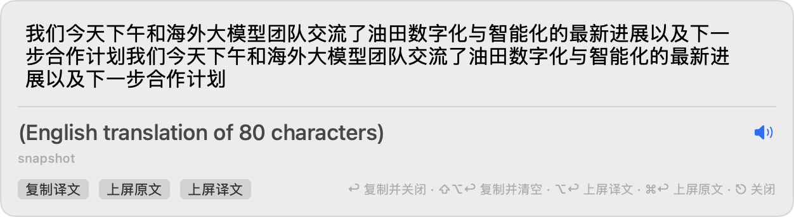

# 译键 YiKey

**一键安装**（macOS 14+，Apple Silicon，需 Xcode 命令行工具；不需要 sudo）：

```bash
git clone https://github.com/rengs/YiKey.git && cd YiKey && ./install.sh
```

或者不用先 clone：

```bash
curl -fsSL https://raw.githubusercontent.com/rengs/YiKey/main/install.sh | bash
```

> **译键 YiKey**：按一个键就能翻译的 macOS 中英互译输入法。“译”是翻译，“键”是键盘/按键；YiKey 读作“译 key”，也有“一键”的意思：按 ⌃⌥T 打开、按 ↩ 就把译文送回去。
> 全部在本机完成：用 Apple 系统自带的离线翻译，**不联网、不用大模型**，内置 1478 条专业术语（石油工程、AI、软件、仪器仪表、单片机），保证行业词翻得准。

*English summary:* **YiKey** is an offline Chinese ⇄ English translating input method for macOS (Swift, InputMethodKit). Type Chinese in a floating panel (your normal Pinyin is switched on automatically) and press Return to get the English text back into the app you were using; copy English anywhere and a Chinese translation pops up next to it. Translation uses Apple's on-device Translation framework only — no network, no LLM. A built-in, user-extensible glossary (1,478 terms: petroleum engineering, AI, software, instrumentation, embedded hardware) keeps domain terms correct. MIT licensed.

<p align="center">
  
  
</p>

---

## 目录
- [它解决什么问题](#它解决什么问题)
- [功能](#功能)
- [快捷键](#快捷键)
- [隐私与离线](#隐私与离线)
- [系统要求](#系统要求)
- [安装](#安装)
- [专业词库与我的词表](#专业词库与我的词表)
- [项目结构](#项目结构)
- [开发与测试](#开发与测试)
- [已知局限](#已知局限)
- [路线图](#路线图)
- [许可证](#许可证)

## 它解决什么问题

和英文同事、客户用微信 / Slack / 邮件交流时，常见流程是：复制英文 → 打开翻译网站 → 粘贴 → 看懂 → 打中文 → 翻成英文 → 复制 → 切回聊天窗口 → 粘贴。
YiKey 把这一串压缩成：

1. **看**：在对方的英文上按 ⌘C，旁边立刻弹出中文译文（还能点 🔊 听发音）。
2. **回**：按 ↩，变成回复框，自动切到简体拼音，直接打中文。
3. **送**：再按 ↩，英文译文自动填进原来那个应用的输入框（**不会替你按发送**），自己确认后回车发送。

专业场景（油田、AI、软件、仪表、嵌入式）里系统翻译常把“抽油机”译成 oil pump、把 water cut 译成“断水器”，YiKey 的离线术语表会在翻译前后自动纠正。

## 功能

**中文 → 英文输入**
- 任何输入法下按 **⌃⌥T** 打开翻译面板；打开时自动切到你已启用的“拼音 – 简体”，关闭时恢复原输入法（只切换，不增删输入源）。
- 边打边译（200 ms 防抖），拼音还在组词时不打断。
- 输入框随文字自动变宽，超过 **35 个汉字**才换行，换行后整体变高，不会裁切第一行。
- **↩ 复制译文并关闭**面板，回到原应用；⇧⌥↩ 复制并清空继续下一句；⌥↩ 直接上屏译文；⌘↩ 上屏原文。
- 先选中一段文字再按 ⌃⌥T 会自动预填（需辅助功能授权）。
- 作为当前输入法时，也可直接打英文：下划线组词 + 光标旁显示中文译文，↩ 上屏原文、⇥ 上屏译文；⌘V 把剪贴板英文粘进组词。

**剪贴板英文监测（兼任翻译软件）**
- 复制英文后自动弹出“📋 剪贴板英文”面板：原文 + 中文译文，位置依次跟随选中文字 / 光标 / 输入框 / 鼠标。
- 面板出现时继续打字，面板自动关闭并把按键还给原应用；⎋ 关闭。
- 菜单可关闭监测或“暂停 1 小时”。空闲开销约为 0（每 0.5 秒只读一次剪贴板计数）。

**回复模式与自动填入**
- 在阅读面板按 ↩ → 回复框（原文以小字保留在上方）→ 打中文 → ↩：英文自动填入**复制英文时所在应用的输入框**。
  找不到输入框时会自动找同窗口里的文本框；实在找不到就复制到剪贴板并提示 ⌘V。
- **永远不会替你按回车发送**；自动粘贴后约 0.5 秒恢复你原来的剪贴板。
- 回复到一半又复制了别的英文：立刻切回阅读新英文，半截草稿暂存，对同一来源再回复时恢复。

**智能过滤（不该弹的不弹）**
- 自己复制的译文、密码管理器内容（Concealed / Transient 类型）、纯链接 / 邮箱、文件路径、数字、中文、重复内容。
- **代码与终端命令**：评分制识别提示符（`$ % # >`）、常见命令（git、brew、npm、swift、curl…约 200 个）、`-x/--flag`、管道 / `&&` / 重定向、`$VAR`、路径、续行、`FOO=bar cmd`，以及 git 输出、`file.swift:12:5: error` 报错、Python 报错堆栈等；
  同时用自然语言特征（大写开头、句末标点、the/you/please 等常用词）抵消，避免误伤“Can you find the git log for me?”这类句子。

**离线专业词库（三层术语机制）**
- 第 1 层 **术语保护**：翻译前找出术语（中文最长匹配；英文整词、不分大小写、认单复数；缩写区分大小写），先把标准译法嵌入原文再翻译，译后逐个核对；有丢失就改用占位符重译，取效果好的一次。
- 第 2 层 **五套内置词库**（共 1478 条，菜单里可分别开关）：石油工程（采油 / 注水 / 地面集输）582、人工智能 213、计算机 / 软件 233、仪器仪表与传感器 232、单片机 / 嵌入式 218。
- 第 3 层 **我的词表**：CSV 文件，保存即生效；支持导入 CSV / TSV / XLSX；面板里“纠正译法”一键把正确译法存进去并立即重译。

**生词本与朗读**
- 只有点击 🔊 才朗读（美式英语），并把这条英文记入生词本（去重、计数）。
- 菜单：查看生词本（搜索 / 删除）、导出 CSV（Excel 可直接打开）/ JSON。

**流畅度**：按键处理在主线程 < 5 ms，翻译、查词表、读取辅助功能信息都在后台；查词表约 0.02–0.06 ms / 句。

## 快捷键

| 场景 | 按键 | 作用 |
|---|---|---|
| 任意应用 | **⌃⌥T** | 打开 / 关闭翻译面板 |
| 翻译面板 | **↩** | 复制译文并关闭（开启“自动填入”时：填入原应用输入框） |
| 翻译面板 | ⇧⌥↩ | 复制译文并清空，面板保持打开 |
| 翻译面板 | ⌥↩ | 上屏译文 |
| 翻译面板 | ⌘↩ / ⇧↩ | 上屏原文 |
| 翻译面板 | ⎋ | 关闭 |
| 剪贴板阅读面板 | **↩** | 用中文回复 |
| 剪贴板阅读面板 | ⎋ | 关闭；其他键：关闭并把按键交还原应用 |
| 英文组词（YiKey 为当前输入法） | ↩ / ⇥ / ⎋ | 上屏原文 / 上屏译文 / 取消 |
| 纠正译法编辑框 | ↩ / ⇥ / ⎋ | 保存并重译 / 切换输入框 / 只关闭编辑框 |

拼音还在组词（有候选）时，↩ 交给拼音输入法确认拼音，不会触发复制。

## 隐私与离线

- 翻译只用 Apple 系统的 **Translation 框架（本机离线）**，首次使用需在系统设置里下载中文、英文语言包（这一步由系统联网下载）。
- **默认不发出任何网络请求**。代码里保留了可选的在线备用翻译（百度 / 自建 LibreTranslate），默认关闭，不配置凭据就不会联网（有单元测试保证）。
- 不使用任何大模型 / 云端 AI。
- 日志（`~/Library/Logs/TranslateIME/`）只记录延迟、面板位置策略和坐标，**不记录你复制或输入的文字**。
- 用户数据都在本机：`~/Library/Application Support/TranslateIME/`（我的词表 `glossary.csv`、生词本 `vocabulary.json`、本机签名证书）。
- 辅助功能权限只用于：读取选中文字、定位光标 / 输入框、自动粘贴译文。不会按回车发送消息。

## 系统要求

- macOS 15 或更高（推荐；macOS 14 没有可编程的系统翻译 API，只能用可选的在线备用）。
- Apple Silicon（arm64）。
- Xcode 命令行工具（`xcode-select --install`）或 Xcode 16+，Swift 6。

## 安装

### 一键安装

```bash
git clone https://github.com/rengs/YiKey.git && cd YiKey && ./install.sh
```

`install.sh` 会：
1. 检查 macOS 版本、芯片、Xcode 命令行工具；
2. 不在仓库目录里运行时（`curl … | bash`），自动把源码 clone 到临时目录；
3. 第一次运行时调用 `scripts/setup_signing.sh` 创建**本机自签名证书**（专用钥匙串，随机密码只存在你本机，不碰登录钥匙串）——这样以后重装，“辅助功能”授权不会失效；
4. `swift build -c release`，组装 `TranslateIME.app` 并签名；
5. 安装到 `~/Library/Input Methods/TranslateIME.app`（只替换这一个文件夹），重启输入法进程；
6. 打印后续步骤。

选项：`./install.sh --no-sign`（跳过证书，用 ad-hoc 签名；每次重装都要重新授权辅助功能）、`--no-restart`。

### 安装后（只需一次）

1. **系统设置 › 键盘 › 文字输入 › 输入法 › 编辑… › “+”**，在“简体中文”里找到 **Translate IME** 添加。看不到就注销重新登录一次。
2. **系统设置 › 通用 › 语言与地区 › 翻译语言…**：下载“中文（简体）”和“英语”。
3. **系统设置 › 隐私与安全性 › 辅助功能**：打开 TranslateIME（自动填入、读选中文字需要；不授权也能用，只是退化为复制到剪贴板）。
   检查：`~/Library/Input\ Methods/TranslateIME.app/Contents/MacOS/TranslateIME --ax-status`
4. 在任意应用按 **⌃⌥T** 试试；或复制一段英文。

### 手动编译

```bash
swift build -c release
bash scripts/setup_signing.sh   # 可选，只需一次
bash scripts/build.sh           # 生成 build/TranslateIME.app
bash scripts/install.sh         # 复制到 ~/Library/Input Methods
```

### 卸载

```bash
./uninstall.sh            # 只删除 ~/Library/Input Methods/TranslateIME.app
./uninstall.sh --purge    # 同时删除我的词表、生词本、日志、本机签名证书
```

### 关于 Bundle ID

项目目前沿用占位 Bundle ID `com.example.inputmethod.TranslateIME`（应用名也仍是 TranslateIME），以免已安装用户的辅助功能授权失效。
如果你要自己分发，可以把 `Resources/Info.plist`、`Resources/*.lproj/InfoPlist.strings`、`Sources/TranslateIME/main.swift`、`scripts/build.sh` 里的 `com.example.inputmethod.TranslateIME` 全部替换成你自己的 ID（替换后需重新添加输入法并重新授权）。

## 专业词库与我的词表

### 内置词库
位置：`Resources/Glossaries/glossary-<领域>.csv`，列为：

```
zh,en,zh_alt,en_alt,flags,note
抽油机,pumping unit,抽油机组,pump jack|pumpjack,,
冲次,strokes per minute,冲数|冲速,SPM,x,
```
- `zh_alt` / `en_alt`：同义写法，用 `|` 分隔，都会换成第一列 / 第二列的标准译法；
- `flags`：`z2e` 只用于中→英（英文是普通词时），`e2z` 只用于英→中，`x` 英→中时把缩写也译成中文（默认缩写原样保留，如 MCU、RAG）；
- 已过滤太宽泛的词（系统、数据、压力、well、pump、unit…）和单字词，并做过中英冲突检查（`swift test` 里也会检查）。

### 我的词表（优先级最高）
文件：`~/Library/Application Support/TranslateIME/glossary.csv`（第一次启动自动创建，UTF-8 带 BOM，Excel / Numbers 直接打开不乱码）：

```
中文,英文,领域,备注
功图计产|功图量油,dynamometer-card-based production metering,石油工程,
井场RTU,wellsite RTU,仪器仪表,
```
- 保存后约 0.3 秒自动生效，不用重启；
- 输入法菜单：**打开我的词表**、**导入词表…**（CSV / TSV / XLSX；同一中文更新，其余追加；CSV 支持 UTF-8 和 GB18030）、**重新加载词表**、术语保护总开关、五套词库各自的开关；
- 翻译面板译文下方点 **纠正译法**：原词自动取输入框里选中的文字，填上正确译法按 ↩ → 存入我的词表并立即重译。

### 效果示例（Apple 本机翻译，真机实测）

| 原文 | 不用词库 | 用词库 |
|---|---|---|
| 请检查3号井抽油机的冲次和冲程。 | …the flush and stroke of the No. 3 well oil pump. | …the strokes per minute and stroke length of the pumping unit of well No. 3. |
| 本月含水率上升到92%，需要调整注水井的配注量。 | The water content… the filling amount… | This month's water cut… the injection allocation of water injection well… |
| The sucker rod pump shows a fluid pound on the dynamometer card. | 吸杆泵在测力计卡上显示液体磅。 | 有杆泵在示功图上显示一个液击。 |
| The gathering system needs a pigging run to remove paraffin deposition. | 收集系统需要一个猪圈来去除石蜡沉积物。 | 集输系统需要清管运行来去除结蜡。 |
| Prompt engineering improves zero-shot performance. | 及时工程改善了零射击性能。 | 提示工程提高零样本学习性能。 |
| The level transmitter uses guided wave radar. | 液位发射器使用导波雷达。 | 液位变送器使用导波雷达。 |

完整 100 句对照见 [`probe/domains.out`](probe/domains.out)（五个领域各 20 句，术语丢失 0）。

## 项目结构

```
install.sh / uninstall.sh       一键安装 / 卸载
Package.swift                   SwiftPM：IMECore（纯逻辑库）+ TranslateIME（输入法 App）+ 测试
Sources/IMECore/                可单元测试的核心逻辑
  LanguageDetector · TranslationService(actor) · TranslationCoordinator · TranslationCache
  ClipboardWatcher（过滤规则）· ShellCommandDetector（终端命令识别）
  Glossary* · TermProtection · FileChangeWatcher · XLSXSheet（术语表）
  AnchorChain · PanelPlacement（面板定位）· ReplyInserter · ReplySession（回复与自动填入）
  CompositionBuffer · InputBoxLayout · Vocabulary · SpeechService · LatencyMonitor
Sources/TranslateIME/           输入法外壳（InputMethodKit + AppKit + SwiftUI）
  main.swift · InputController · AppContext · FloatingPanel · PanelViews
  AppleTranslation（Translation 框架桥接）· HotKey · InputSources · GlossarySupport · VocabularyWindow …
Resources/                      Info.plist、本地化名称、Glossaries/*.csv（内置词库）
scripts/                        build.sh · install.sh · setup_signing.sh · make_icon.swift · gen_xctest_bridge.py …
Tests/IMECoreTests/             262 个单元测试
probe/                          翻译对照实验的输入与结果
docs/DEV_NOTES.md               详细设计与开发记录；FIXES.md 修复记录
```

## 开发与测试

```bash
swift test          # 不要设置 DEVELOPER_DIR；只装命令行工具也能跑（XCTestShim + swift-testing 桥接）
```
- 覆盖：语言判别、翻译回退链与超时、缓存、发音只在点击时触发、输入框尺寸、面板定位、剪贴板过滤（含 73 条终端命令 / 28 条自然英文样本）、
  回复与自动填入、术语匹配 / 占位符还原 / 两个方向 / 用户优先 / 热重载 / CSV·XLSX 解析、性能（查词表 < 1 ms / 句）。
- 新增测试文件后运行 `python3 scripts/gen_xctest_bridge.py` 重新生成桥接。
- 真机诊断：`TranslateIME --ax-status`、`--selftest-translate probe/domains.tsv out.tsv --glossary`（用真实 Apple 翻译对比加 / 不加词库）。

## 已知局限

- 只支持简体中文 ⇄ 英文；翻译质量取决于 Apple 本机翻译模型，术语之外的部分无法控制。
- 用占位符回退时英文可能缺冠词（“has memory leak”），句首术语有时少了 The。
- 极短且无命令特征的命令（如单独的 `make`、`echo hello`）仍可能被当成英文弹出；英文句子里夹着命令时按句子翻译。
- 自动填入依赖“辅助功能”和目标应用的可访问性实现，个别应用（自绘界面、游戏、部分 Electron 应用）可能只能退化为复制 + 提示 ⌘V。
- 自签名证书只在本机有效，暂不提供预编译安装包（他人无法直接运行未公证的二进制）。
- 只构建 arm64。

## 路线图

- [ ] 菜单里一键修改快捷键、面板字号
- [ ] 更多专业词库（化工、电力、医疗）与词库社区贡献流程
- [ ] 术语表支持词形变化更丰富的英文匹配（动词时态等）
- [ ] 签名公证后的预编译版本（Homebrew Cask）
- [ ] 繁体中文、日文
- [ ] Intel Mac 通用二进制

## 许可证

[MIT](LICENSE) © 2026 YiKey contributors
